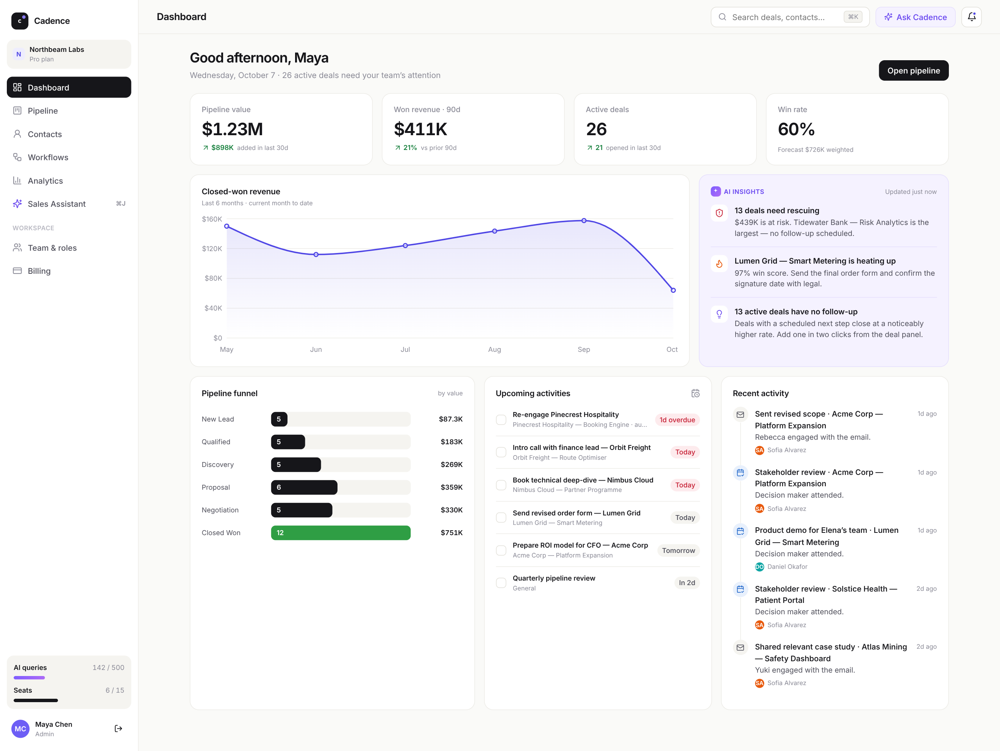
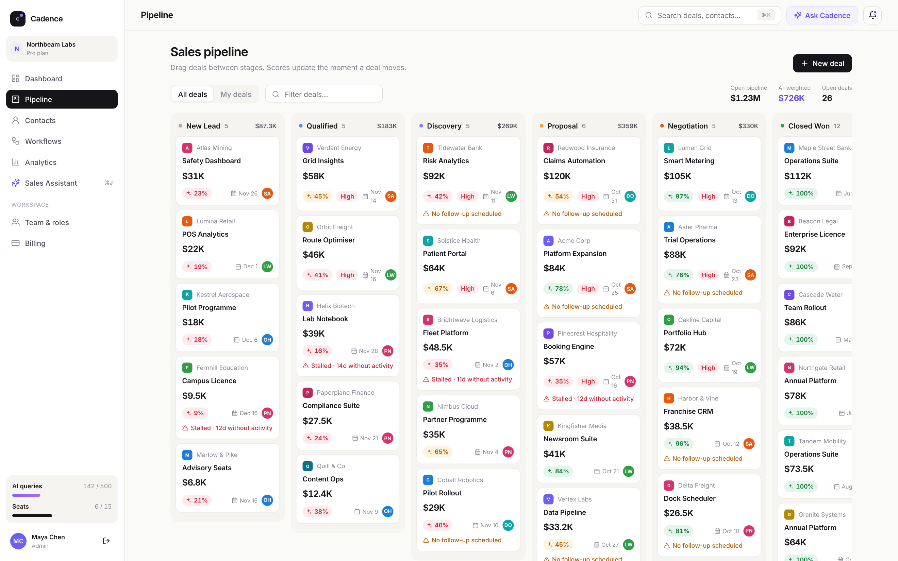
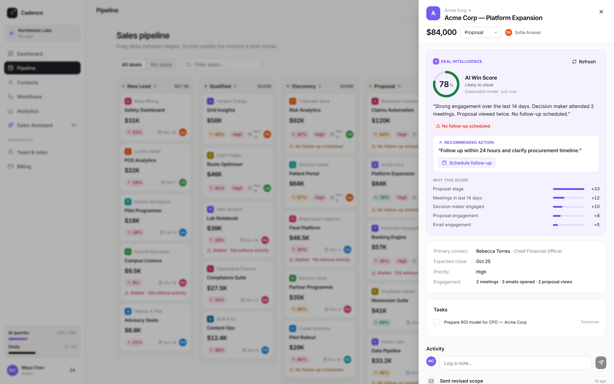
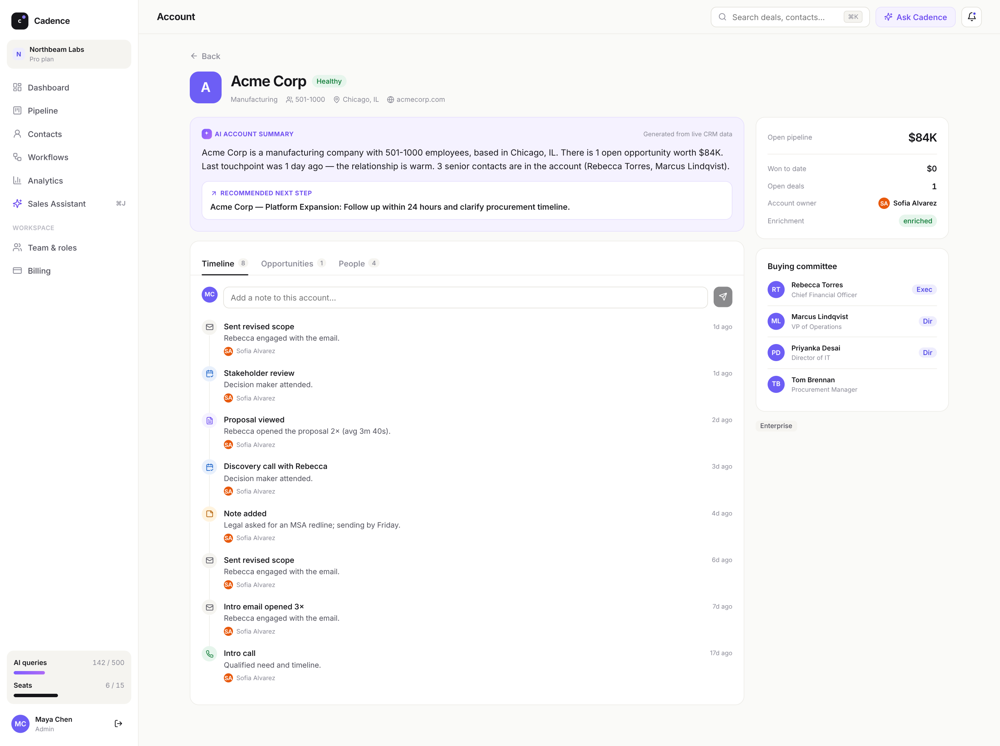
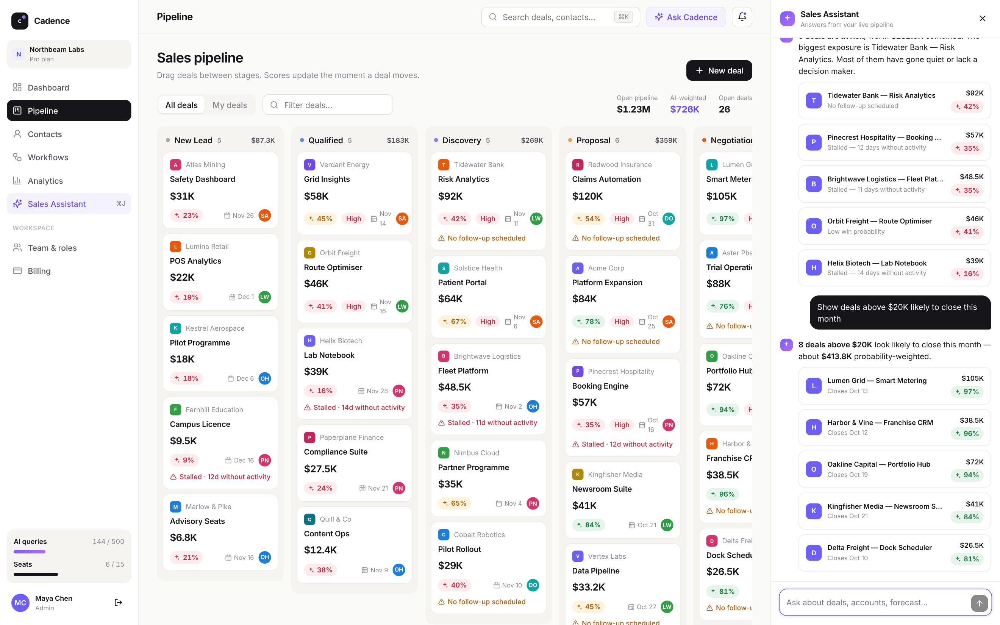
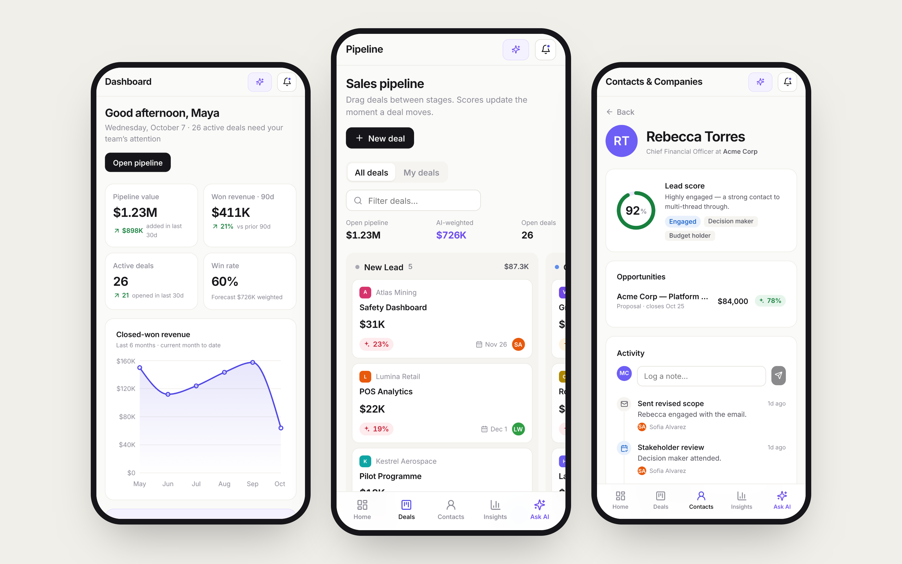

# Cadence — AI-Powered CRM SaaS

A production-style CRM for 10–100 person B2B sales teams. Multi-tenant workspaces, role-based access, a drag-and-drop pipeline, **explainable AI deal intelligence**, workflow automation, analytics & forecasting, and per-seat Stripe billing — in one MERN codebase.



| | |
|---|---|
|  |  |
|  |  |



## What's inside

| # | Screen | Highlights |
|---|---|---|
| 1 | **Dashboard** | Pipeline value, won revenue, win rate, funnel, revenue trend, AI insight feed, upcoming tasks, recent activity |
| 2 | **Pipeline** | Native drag-and-drop Kanban (optimistic updates), win score + stall warnings on every card, new-deal modal |
| 3 | **Account / Contact 360°** | AI account summary + recommended next step, timeline, buying committee, notes |
| 4 | **AI Sales Assistant** | Side panel (`⌘J`) answering *"Which deals are at risk?"*, *"Summarize Acme Corp"*, *"What should I follow up today?"*, *"Deals above $20K likely to close this month"* — with clickable deal cards |
| 5 | **Contacts & Companies** | Search, filters, lead score, enrichment status, tags, bulk actions (assign / tag / enrich / delete) |
| 6 | **Workflow builder** | Trigger → conditions → actions, run log, "Run inactivity check" |
| 7 | **Analytics & forecasting** | Commit / upside / AI-weighted forecast, win-loss, sales velocity, stage conversion & dwell time, team performance, AI bottlenecks |
| 8 | **Team & RBAC** | Admin / Manager / Rep roles, invitations (shareable link), permission matrix |
| 9 | **Billing** | Free / Pro / Business, usage meters, Stripe Checkout + portal + webhook, plan limits enforced by the API |
| 10 | **Responsive** | Bottom tab bar, card lists, snap-scrolling pipeline, full-screen drawers |

### The AI feature (not just a chat box)

Every deal carries a **Deal Intelligence** card: AI Win Score, a plain-language summary, risk chips, a recommended action (one click schedules the follow-up), and a **"Why this score"** breakdown.

* The score comes from a **deterministic, explainable model** (`server/src/services/scoring.js`): stage probability, meetings, proposal views, email engagement, decision-maker involvement, follow-up scheduled, inactivity and overdue close dates.
* With `OPENAI_API_KEY` set, an LLM only **rewrites the narrative and action** — it never invents the number.
* Without a key, the same narrative is produced by the rules engine, so the app works fully offline.

## Tech

React 18 · Vite · React Router · Recharts · hand-written design system (no UI kit) — Node 18+ · Express · Mongoose / MongoDB · JWT · bcrypt · Helmet · rate limiting · OpenAI SDK · Stripe SDK.

```
server/src
  models/        Mongoose schemas (tenant-scoped)
  middleware/    auth, RBAC, error handling
  routes/        auth · deals · contacts · companies · insights · workspace · billing
  services/      scoring (AI) · assistant · automation · limits
  seed.js        deterministic demo data (38 companies, 88 contacts, 47 deals, stage history)
client/src
  pages/         one file per screen
  components/    Layout · DealPanel (global drawer) · Assistant · ui primitives
scripts/         api-smoke.mjs (31 checks) · screenshots.mjs (Playwright)
```

## Run it locally

Requires Node 18+ and MongoDB (local, Docker, or Atlas).

```bash
cp .env.example server/.env          # edit MONGO_URI / JWT_SECRET
npm run setup                        # installs root, server and client
npm run seed                         # loads the demo workspace
npm run dev                          # API :4000 + web :5173
```

Open http://localhost:5173 → **Explore the demo workspace**, or sign in with
`maya@northbeam.io` / `cadence-demo` (admin). Other roles: `daniel@northbeam.io` (manager), `liam@northbeam.io` (rep) — same password. `iris@foxglove.dev` is a separate tenant used to prove isolation.

**One command with Docker:** `docker compose up --build` → http://localhost:4000 (auto-seeds an empty database).

### Production build

```bash
npm run build && npm start           # Express serves client/dist on :4000
```

## Go live

* **Render** — push to GitHub, "New → Blueprint" (uses `render.yaml`), paste a free MongoDB Atlas URI into `MONGO_URI`, set `CLIENT_URL` to your Render URL. `AUTO_SEED=true` fills the empty DB on first boot so the demo is live immediately.
* **Railway / Fly.io** — use the included `Dockerfile` (single service, API serves the client).

## Real Stripe & OpenAI

* **Stripe:** set `STRIPE_SECRET_KEY` (test mode is fine). Checkout is created with inline per-seat `price_data`, so no dashboard products are needed. Add a webhook to `/api/billing/webhook` for `checkout.session.completed` and `customer.subscription.*` and set `STRIPE_WEBHOOK_SECRET`. The success redirect also confirms the session directly, so it works on localhost without the CLI. Locally: `stripe listen --forward-to localhost:4000/api/billing/webhook`.
* **OpenAI:** set `OPENAI_API_KEY` (model via `OPENAI_MODEL`). Used for deal-insight narration and free-form assistant questions.

Without keys, billing runs in a clearly labelled **demo mode** (simulated checkout) and AI uses the rules engine.

## Security model

* JWT carries user + workspace; every query is filtered by `workspaceId` (cross-tenant reads and writes return 404).
* Roles enforced on the server: reps edit only their own deals; managers edit everything and build workflows; admins manage team and billing.
* Plan limits (seats, active deals, AI queries) return `402` with an upgrade prompt in the UI.
* Helmet, CORS, rate-limited auth and AI routes, bcrypt password hashing, Stripe webhook signature verification.

## Tests & screenshots

```bash
npm run test:api       # 31 end-to-end checks: auth, RBAC, tenant isolation, plan limits, AI, workflows, billing
npx playwright install chromium && npm run screenshots   # regenerates /screenshots from the live app
```

## Honest limitations

* **Verified here:** the full API test suite (31/31), a production client build, and every screen rendered and screenshotted at desktop and mobile sizes with zero console errors. The sandbox ran against **FerretDB** (a MongoDB-compatible server) rather than `mongod` itself; queries are deliberately plain (find + JS aggregation) so they behave identically on MongoDB.
* **Not exercised here:** live Stripe and OpenAI calls (no keys in the sandbox) — those code paths follow the official SDKs but have only run in demo/rules mode.
* **Simulated:** contact "enrichment" flips status and score (hook for Clearbit/Apollo); invitations produce a copyable link rather than sending email; invoice history in demo mode is derived from the plan.
* No unit-test suite beyond the API integration script, and no email/calendar sync.
* All company and people names in the seed are fictional.

## Upwork portfolio copy

**Title:** AI-Powered CRM SaaS | MERN, OpenAI, Stripe & Automation
**Role:** Full-Stack MERN Developer | SaaS Architecture, AI & API Integrations
**Skills:** MERN Stack Development · SaaS Development · React · Node.js · Artificial Intelligence
**Description (~470 chars):** Built a production-style AI CRM SaaS for sales teams to manage leads, contacts, companies and deals in one workspace. Developed with React, Node.js, Express and MongoDB, with secure authentication, multi-tenant workspaces, RBAC, visual sales pipelines, activity tracking, workflow automation, analytics and Stripe subscriptions. AI features generate CRM summaries, prioritize opportunities, flag deal risks and recommend next actions. Responsive across desktop and mobile.

**Suggested image order:** `mobile-trio` (cover) → `03-deal-intelligence` → `02-pipeline` → `01-dashboard` → `05-ai-assistant` → `04-company-360` → `08-analytics` → `07-workflows` → `09-team-rbac` → `10-billing`.
